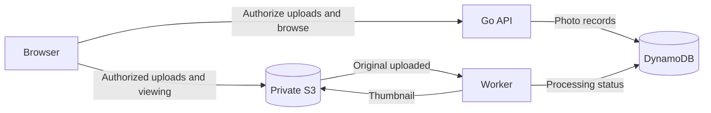

# tagged

A private photo library for uploading, searching, and organizing photos from desktop or mobile.

The finished app will combine manual and AI-generated tags to make your library searchable, let you correct tags and apply new ones to older photos, and surface untagged images for review. It will group similar shots so you can choose the best and delete unwanted copies.

## Upload architecture

